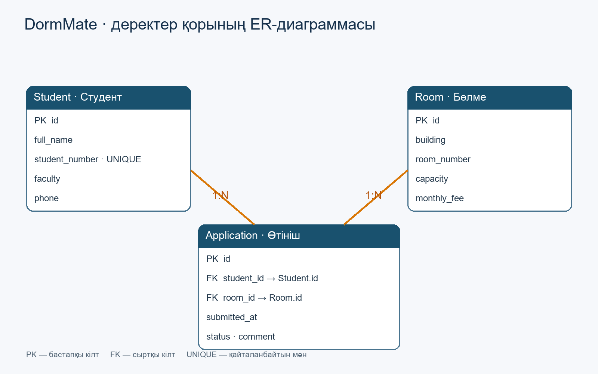

# DormMate — жатақханадағы орын мен өтініштерді басқару жүйесі

**Курс:** Қолданбалы ақпараттық жүйелер (2026)  
**Автор:** Жұматай Нұрсая (тобыңызды енгізіңіз)

## 1. Жоба сипаттамасы
DormMate — жатақхана бөлмелерінің бос орындарын және студенттерден келген өтініштерді басқаруға арналған ақпараттық жүйе. Әкімші студенттер мен бөлмелерді тіркеп, іздеп, жаңартып, жоя алады; өтініштерді қарастырып, мәртебесін өзгерте алады. Қабылданған өтініштердің саны бөлме сыйымдылығымен салыстырылып, орын толық болса тағы бір өтінішті бекітуге рұқсат берілмейді.

## 2. ER диаграммасы


- `Student`: студенттің аты, билеті, факультеті және телефоны.
- `Room`: корпус, бөлме нөмірі, сыйымдылығы және айлық төлемі.
- `Application`: студенттің бөлмеге өтініші, мәртебесі, күні мен түсініктемесі.
- `Student` (1:N) `Application`; `Room` (1:N) `Application`.

## 3. Технологиялар
- **Backend:** Python 3.11+, FastAPI, Uvicorn
- **Деректер базасы:** SQLite, SQLModel
- **Frontend:** Streamlit және Requests
- **Тестілеу:** pytest, httpx, FastAPI TestClient
- **Контейнерлеу:** Docker, Docker Compose
- **Әзірлеу:** VS Code және AI көмекші

## 4. Жоба құрылымы
```text
DormMate/
├── app/
│   ├── database/
│   │   ├── db.py           # SQLModel engine / sessions
│   │   ├── models.py       # ORM кестелер, схемалар
│   │   └── seed.py         # демо деректер
│   ├── routers/
│   │   ├── students.py     # студенттер CRUD
│   │   ├── rooms.py        # бөлмелер CRUD және сүзгілеу
│   │   └── applications.py # өтініштер CRUD
│   ├── frontend/
│   │   └── ui.py           # Streamlit интерфейсі
│   └── main.py             # FastAPI іске қосу
├── tests/
│   ├── conftest.py         # оқшауланған тест базасы
│   └── test_api.py         # API интеграциялық тесттері
├── docs/
│   ├── er-diagram.png
│   └── AI_PROMPTS.md
├── Dockerfile
├── Dockerfile.frontend
├── docker-compose.yml
├── .dockerignore
├── .gitignore
├── requirements.txt
├── Start_DormMate.bat
└── README.md
```

## 5. Windows-та іске қосу (Docker қолданбай)
Жоба папкасын архивтен толық шығарыңыз. **Python 3.11+** және интернет қажет (бірінші орнатуға).

**Оңай жол:** `Start_DormMate.bat` файлын екі рет басыңыз: ол виртуалды ортаны құрып, кітапханаларды орнатып, тест деректерін қосып, екі серверді іске қосады.

**Терминал арқылы:**
```powershell
py -3 -m venv .venv
.venv\Scripts\python.exe -m pip install -r requirements.txt
.venv\Scripts\python.exe -m app.database.seed
.venv\Scripts\python.exe -m uvicorn app.main:app --reload
```
Екінші терминалда:
```powershell
.venv\Scripts\python.exe -m streamlit run app/frontend/ui.py
```
- Интерфейс: http://localhost:8501
- API және Swagger: http://localhost:8000/docs

## 6. Docker арқылы іске қосу — ЛР №6
**Docker Desktop** орнатылып, іске қосулы болуы керек. Жоба папкасындағы терминалда:
```bash
docker compose up --build
```
- Интерфейс: http://localhost:8501
- Swagger: http://localhost:8000/docs
- Деректер Docker-дің `dormmate_data` volume ішінде сақталады; `docker compose down` оларды өшірмейді.
- **Демо деректер керек болса:** контейнерлер іске қосылғаннан кейін `docker compose exec backend python -m app.database.seed` орындаңыз.
- Тоқтату: `docker compose down`.
- **Маңызды:** `docker compose down -v` деректер volume-ын да жояды.

## 7. API маршруттары — ЛР №3–4
| Ресурс | Әдістер | Іздеу/сүзгі |
|---|---|---|
| `/students` | GET, POST, GET /{id}, PATCH /{id}, DELETE /{id} | `search` |
| `/rooms` | GET, POST, GET /{id}, PATCH /{id}, DELETE /{id} | `building`, `min_fee`, `max_fee` |
| `/applications` | GET, POST, GET /{id}, PATCH /{id}, DELETE /{id} | `status`, `student_id` |

Жоқ жазба — `404`; белсенді өтініш/толған бөлме сияқты қайшылықтар — `409`; қате енгізу — `422`.

## 8. Streamlit интерфейсі — ЛР №5
Интерфейсте 3 бөлім бар: **Бөлмелер**, **Студенттер**, **Өтініштер**. Сүзгілеу мен іздеу, кестелерді көру, жаңа мәлімет енгізу, мәліметтерді өзгерту және жою іске асырылған. Streamlit API-ға HTTP арқылы сұраныс жібереді; деректер SQLite базасында сақталады.

## 9. Автоматты тесттер — ЛР №7
Python ортасында тәуелділіктерді орнатқан соң:
```bash
python -m pytest -v
```
Windows-та `.venv` қолдансаңыз:
```powershell
.venv\Scripts\python.exe -m pytest -v
```
6 тест сценарийі бар: жүйенің жауабы, CRUD, іздеу, валидация, қайталанған студент, өтініш/бөлме сыйымдылығы, 404/409/422 қателері. Тесттер арнайы **жадтағы SQLite** базасында өтеді, негізгі `dormmate.db` файлын өзгертпейді.

## 10. GitHub-қа өткізу
`venv`, `.venv`, `dormmate.db`, `.env` файлдары `.gitignore` ішінде. Кодты жіберу:
```bash
git add .
git commit -m "feat: complete Streamlit Docker and API tests"
git push origin main
```
GitHub-та файлдар мен ER диаграмма көрінетінін тексеріңіз. Қорғауда Streamlit бетін, `/docs` құжатын және `pytest` нәтижесін көрсетіңіз.
