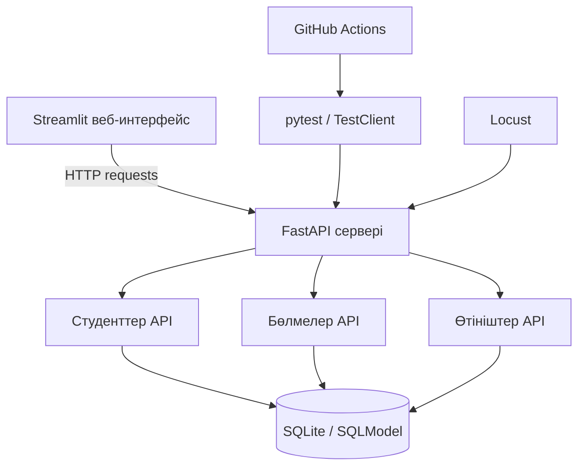

# DormMate — Лабораториялық жұмыс №8. Архитектура

Ескерту: бастапқы репозиторий сипаттамасында авторизация модулі көрсетілмеген. Сондықтан оны бар деп көрсетуге болмайды; №5 қауіпсіздік тапсырмасы үшін қауіпсіздік олқылығы ретінде бағалау керек.

| Компонент | Қате 1 | Қате 2 | Интеграциялық тексеріс |
|---|---|---|---|
| Streamlit | API серверіне қосыла алмау | Қате жауапты көрсете алмау | UI → API |
| FastAPI | Қате маршрут | Деректер схемасы сәйкес емес | API → DB |
| SQLite | Бірегей кілт қайшылығы | Транзакция сәтсіздігі | API → DB |
| CRUD маршруттары | Жоқ ID (404) | Дерек қайшылығы (409) | Маршрут → SQLModel |
| Валидация | Міндетті өріс жоқ | Сыйымдылық нөл (422) | Клиент → API |
| Қауіпсіздік | Авторизация жоқ | Рөлдік шектеу жоқ | Талап ретінде қосымша енгізу қажет |
